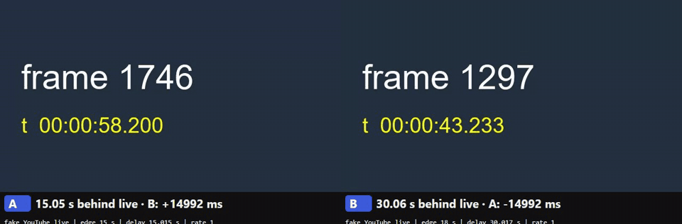

# costream-sync

Co-streamers who watch the same YouTube live broadcast each see it with a different delay, so
they react to different moments. costream-sync lines their players up **to within about one video
frame**. Streamers keep watching on youtube.com as normal. A Chrome extension shifts the page's
own player, and a small server coordinates who syncs with whom.



*Two Chrome windows with the extension, on the local fake YouTube page used for testing. B starts
15 s behind A (frame 1309 vs 1759). A clicks Match, B accepts, and A pauses. Both then show the
same frame, give or take one (1886 vs 1887). The caption shows the offset measured from the
frame counter.*

**Example.** A sees a kill 3 s after it happens, B 8 s after. A clicks B, B accepts, and A's
player pauses 5 s, then fine-tunes its speed. Both now see the kill at the same moment, and the
sync holds through ads, rebuffers and page reloads until someone leaves.

## How it works

```
 Streamer's PC                                    Server
┌──────────────────────────────────────────┐     ┌─────────────────────────────┐
│ youtube.com tab                          │     │ sync server (FastAPI, WS)   │
│  page.js     reads YouTube's player      │     │  clock: NTP-style pings     │
│  content.js  measures the frame on       │     │  rules: who syncs, target   │
│              screen; pause/skip/speed    │◄───►│  offers: accept / decline / │
│  background  connection, clock, checks   │ WS  │          15 s timeout       │
├──────────────────────────────────────────┤     │  serves the panel page      │
│ panel (browser window or OBS dock)       │◄───►│                             │
│  group, Match / Sync all, offers, offset │     └─────────────────────────────┘
└──────────────────────────────────────────┘     (later: Discord bot = groups)
```

- **One clock for everyone.** Every client converts its time to the server's with NTP-style
  pings, keeping the lowest round trips. One test PC was 2.3 s slow, and this cancels it.
- **What's on screen, frame-exact.** `requestVideoFrameCallback` tells the extension which frame
  was shown and when. YouTube's player clock (`getCurrentTime()`) is identical for every viewer
  of the same frame: measured in two tabs, the same to 0.1 ms. So a sync target is sent as a
  position on that clock, with one reference stamp per sync.
- **Live edge.** YouTube's newest-chunk marker only moves when the player downloads, so the
  extension keeps the live head moving in real time between downloads.
- **Rules** ([docs/DESIGN.md](docs/DESIGN.md)):
  - The group syncs at its slowest member's live edge.
  - Nobody goes beyond their max extra delay (default 30 s).
  - Nobody is more than 10 s behind the fastest member.
  - The largest group whose ranges overlap wins.
  - Offers are worded from where you are now ("Accepting will skip your stream forward 16 s").
- **Applying it.**
  - Pause to add delay; this is exact, measured +4.00 s for a 4 s pause.
  - Skip forward to remove delay.
  - Then fine-tune at 0.98–1.02× speed (pitch preserved), continuously.
  - Nothing is ever drawn on the YouTube page, because streamers capture it in OBS.
- **Safety.** The extension acts only on a sync this user accepted, re-checks the user's max
  itself, and "Leave sync" restores normal playback at once.

## Measured results

**On real YouTube** (a 24/7 live stream):
- The frame's capture time from the page player, read over 10 s, varied by only 0.02 s
  (41.932–41.949 s).
- Cross-checked against the HLS playlist's `#EXT-X-PROGRAM-DATE-TIME`: the same clock, and the
  page gets each chunk about 1 s earlier.

**Simulator** (`demo/sim/`): virtual users run the real extension logic against a fake player,
with their own network and clock, through the real server. Pass or fail comes from ground truth.

| Scenario | Conditions | Worst offset |
|---|---|---|
| nearby | B's clock 2.3 s slow; B 16 s behind its live edge | 14 ms |
| doc_example | 4 users, Sync all; one left out by the 10 s gap rule | 8 ms |
| youtube_head | users sitting closer to live than the safety margin | 7 ms |
| reload_and_errors | YouTube error + refresh, page reload, rebuffer | 2–18 ms |
| copenhagen_sydney | 200 ms out / 100 ms back, ±40 ms jitter, 2% loss, drifting clock, 30 s ad | 72–79 ms |

The last row is limited by the network: a lopsided route (200 ms out, 100 ms back) shifts any
clock estimate by (200 − 100) / 2 = 50 ms, and no client can detect that.

**End-to-end** (`demo/e2e/`): two headless Chromium windows with the real extension on a local
fake YouTube page. The offset is measured from the video's frame counter.

| Step | Mean offset | Worst sample |
|---|---|---|
| before (B starts 15 s behind) | +14,983 ms | |
| after A clicks Match and B accepts | 7.7 ms | 25.3 ms |
| after an 8 s ad on B | 4.7 ms | 25.4 ms |
| after A reloads the page (rejoins, no new offer) | −1.5 ms | 25.1 ms |
| after a YouTube error on B + refresh | −3.2 ms | 17.2 ms |

Screens only show whole frames (33 ms at 30 fps), so two players 8 ms apart read as −8 ms or
+25 ms depending on where the frame boundary falls. The test therefore requires a mean within
16.7 ms (half a frame at 30 fps), and no sample more than two frames apart.

## Run it

You need Python 3.12+ and Node 20+.

```powershell
git clone https://github.com/LierMutube40496253/costream-sync.git
cd costream-sync
py -m venv .venv
.\.venv\Scripts\python.exe -m pip install -r requirements.txt
.\.venv\Scripts\python.exe -m playwright install chromium
npm install
```

- **Server and panel:** `.\.venv\Scripts\python.exe -m server`, then open `http://localhost:8765/panel/`.
  Settings come from `.env`; copy `.env.example`, which needs no secrets yet.
- **Extension:** `chrome://extensions` → Developer mode → Load unpacked → the `extension`
  folder. Until the Discord login exists, connect it from its service-worker console:
  `costream.join({server: 'ws://localhost:8765', room: 'test', user: 'A', maxDelay: 30})`.
- **Two PCs on real YouTube:** step by step in [docs/MANUAL_TEST.md](docs/MANUAL_TEST.md).

## Tests

```powershell
.\.venv\Scripts\python.exe -m pytest -q                # everything Python, about 4 min
.\.venv\Scripts\python.exe -m pytest -q -m "not e2e"   # quick: server rules and protocol (21)
npx vitest run                                         # extension logic (34)
npm run sim:all                                        # 5 simulator scenarios, about 10 min
.\.venv\Scripts\python.exe demo\e2e\two_window_e2e.py --headed   # watch the end-to-end test
.\.venv\Scripts\python.exe demo\e2e\record_demo.py     # re-record docs/demo.gif
```

`pytest` includes the browser tests (marked `e2e`):
- the two-window end-to-end test above
- the panel test: A clicks Match in A's panel, B's panel shows "Accepting will skip your stream
  forward 16.0 s", B accepts, and both panels show the result

## Limitations

- **Relies on undocumented YouTube player functions:** `getCurrentTime`,
  `getMediaReferenceTime`, `getProgressState`, `getVideoStats` and `getVideoData` on
  `#movie_player`. YouTube can change or remove them at any time. The extension then stops
  measuring (the panel shows "waiting for video") instead of syncing wrongly, and the live
  smoke checks (`tools/youtube_checks.py`) are there to notice it.
- **Automated browsers on real YouTube are unreliable.** In automated test windows, YouTube
  showed "Something went wrong" about 30 s into playback, even with no extension loaded. That's
  why the tests use the fake page, and real YouTube is tested by hand (docs/MANUAL_TEST.md).
- **Across continents, precision is set by the network**, as described under Measured results.
- **Not built yet:** the Discord login and bot (groups = voice channel members), and CI. Twitch
  is out of scope, because its player can't rewind live.

## Project layout

| Path | What |
|---|---|
| `server/` | sync rules (`sync_logic.py`) and the WebSocket server + panel hosting (`app.py`) |
| `extension/` | Chrome MV3 extension; `sync_math.js`, `controller.js` and `client_core.js` also run in Node for the simulator and tests |
| `panel/` | the panel page, served at `/panel/` |
| `demo/sim/` | far-apart simulator with live graph (`node demo/sim/run.js <scenario>`, graph at `http://localhost:8790`) |
| `demo/e2e/` | fake YouTube page, end-to-end test, demo recording |
| `tools/` | `delay_probe.py` (HLS timestamp probe) and `youtube_checks.py` (live smoke checks) |
| `docs/` | `DESIGN.md` (design, source of truth), `MANUAL_TEST.md`, `demo.gif` |

## License

MIT, see [LICENSE](LICENSE).
